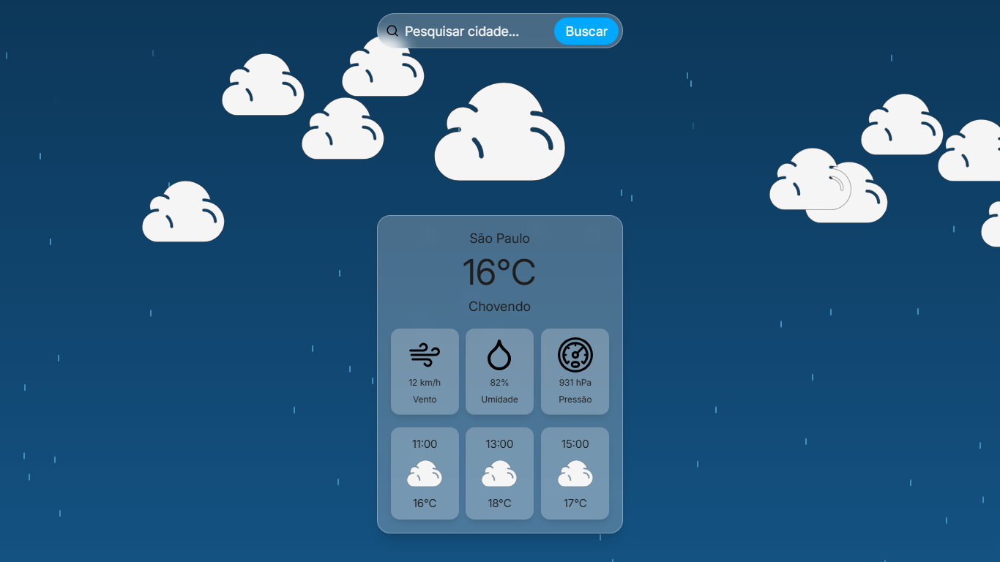
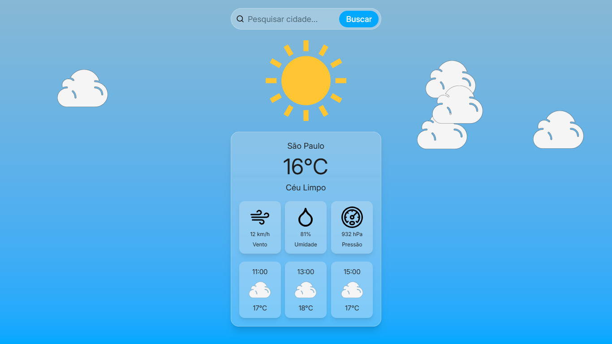
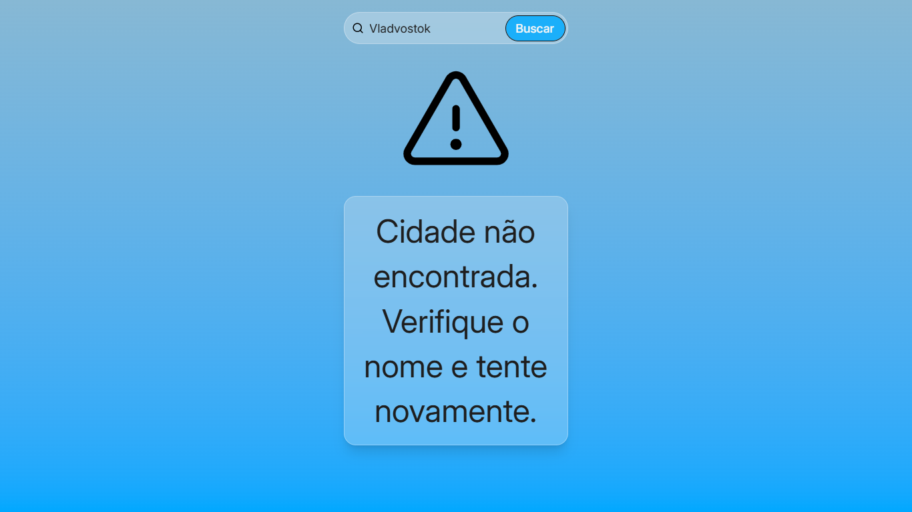

# TailwindCSS - WeatherApp

## Descrição
Aplicação web de previsão do tempo utilizando a API Open-Meteo e estilizada com Tailwind CSS, com foco em interface dinâmica com mudanças visuais dependendo da previsão e período do dia.

## Funcionamento: 
1. O usuário digita o nome da cidade e clica em buscar;
2. Se for uma cidade existente aparece a temperatura, condição climática, vento, umidade e pressão no momento da busca e a previsão de temperatura das próximas seis horas;
3. O fundo, ícones e animações (como de gotas de chuva e flocos de neve) aparecem conforme a situação meteorológica;
4. Se a cidade for inválida aparece uma mensagem de erro e icone de alerta

## Demonstração
- Aplicação: https://heitorcfcazella-prog.github.io/Tailwindcss-WeatherApp/
- Capturas de tela: 




## Tecnologias 
- HTML
- JavaScript
- Tailwind CSS
- Open-Meteo API
- Figma

## Como executar

### Pré-requisitos
- Navegador Moderno
- Node.js e NPM
- Git
- Extensão Live Server no VS Code

### Clonar repositório
```bash 
git clone https://github.com/heitorcfcazella-prog/Tailwindcss-WeatherApp.git
```

### Abrir o projeto
1. Abra a pasta principal no VS Code
2. Ligar a extensão Live Server para o arquivo index.html
3. Utilizar a aplicação

### Para editar o CSS
1. Abra o terminal na pasta /app
2. Execute o comando: 
```bash 
npm run dev
```
3. Edite livremente o CSS pelo arquivo input.css

## Aprendizados
- Consumo de API
- Processamento de dados recebidos em formato JSON
- Manipulação dinâmica do DOM
- Tratamento de erros
- Estilização com Tailwind CSS

## Referencias

### Telas
- https://dribbble.com/shots/26737353-Weather-app-concept
- https://dribbble.com/shots/7171214-Weather-App-UI

### Sites dos SVG
- SVG Repo
- Phosphor Icons
- Lucide.dev